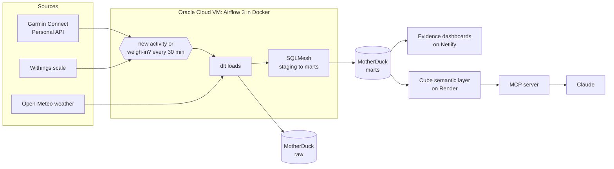

# My running data, on free tiers

A side project to try some data tools on something I care about: my running. Garmin records every run, Withings every weigh-in, and I wanted personal bests, km splits, pace in the heat and long-term trends without paying for Strava Premium. So this pulls my own data out of Garmin and Withings, models it, and serves it as dashboards and as something I can ask Claude about, on free tiers only. It costs nothing to run.

**Live dashboards: [dainty-toffee-9e280f.netlify.app](https://dainty-toffee-9e280f.netlify.app)** (Running, Activities and Weight pages).

## How it fits together



| Tool | Does | Runs on (free) |
|---|---|---|
| [dlt](https://dlthub.com) | loads Garmin, Withings and Open-Meteo into the warehouse, incrementally | the Airflow server |
| [MotherDuck](https://motherduck.com) | the warehouse (DuckDB in the cloud) | MotherDuck free plan |
| [SQLMesh](https://sqlmesh.com) | models raw data into marts: daily health, activities, km splits, best efforts, weather per run; audits and linting | the Airflow server; state in [Neon](https://neon.tech) Postgres |
| [Airflow 3](https://airflow.apache.org) | runs the loads when new data arrives, then the models | Oracle Cloud Always Free VM |
| [Evidence](https://evidence.dev) | the dashboards, built as a static site | Netlify |
| [Cube](https://cube.dev) | semantic layer (`health`, `training`, `body`, `splits`, `efforts` views) over the marts | Render |
| MCP server | lets Claude query Cube: *"How has my 10 km pace changed since last summer?"* | Render, and locally for Claude Code |
| [ntfy](https://ntfy.sh) | a phone notification when a task fails | ntfy.sh |

## Problems worth a look

- **Runs, not cron.** Garmin can't notify anyone of a new activity, so Airflow asks every 30 minutes with one small API call that never touches the warehouse, and loads only when something is new. The loads hand over to the models through Airflow Assets, and SQLMesh's `allow_partials` processes today so far, so a run is in the dashboards' data within the hour. ([`airflow/dags/`](airflow/dags/), [`ingest/changes.py`](ingest/changes.py))
- **A token that rotates on every login.** Withings issues a new refresh token each time one is used. It lives in one Postgres row, locked during a refresh so two runs can't spend the same token, and the 3-hour access token is reused, which cuts logins from 48 a day to about 8. ([`ingest/withings_auth.py`](ingest/withings_auth.py))
- **Splits without a splits API.** The Personal API has no splits or laps, so km splits and best efforts (fastest 1 km, mile, 5 km to marathon *within* any run) are calculated from each run's per-second recording. Since 2025 they match Garmin's own figures to 0.1 s. ([`transform/models/marts/`](transform/models/marts/))
- **Flaky upstream.** Garmin sometimes answers 504 for a recording. That activity is skipped, remembered in dlt's state and fetched again on the next runs, rather than failing the whole load. ([`ingest/garmin_source.py`](ingest/garmin_source.py))
- **Staying free.** Netlify builds cost credits, so the dashboards rebuild on Mondays and Thursdays and skip a build that starts late. Airflow fits a 6 GB ARM VM with one web worker and swap. Its UI is reachable only through an SSH tunnel, so the only open port is SSH.
- **Privacy.** Open-Meteo only ever receives a run's start point rounded to about 11 km, never the route; GPS isn't loaded at all.
- **Asking questions.** Claude (Code, or claude.ai through an OAuth-locked remote MCP server) queries the Cube views rather than raw SQL, so answers use the same definitions as the dashboards.

| Path | What it does |
|---|---|
| `ingest/` | dlt sources: Garmin Personal API (`daily_summaries`, `activities` with `split_summaries`, `activity_samples`, `sleep`, `hrv`, `vo2max`), Withings (`measures`: weight and body composition) and Open-Meteo (`hourly` weather for the area each activity starts in); `changes.py` has the cheap new-data checks |
| `transform/` | SQLMesh project (`config.py` picks the gateway: `local` or `motherduck`) |
| `airflow/` | the DAGs, a local setup (`setup.sh`, `run.sh`) and the server's Docker Compose stack (`server/`) |
| `semantic/` | Cube models and views, Render Dockerfile, MCP servers, local-model chat |
| `dashboards/` | Evidence project; `netlify.toml` builds it on Netlify |

The rest of this README is how to build it yourself.

## Secrets

| Secret | Where | Used by |
|---|---|---|
| Garmin personal API key | `.env` | dlt |
| MotherDuck token (read/write) | `.env` | dlt, SQLMesh |
| Netlify build hook URL | `.env` | `rebuild_dashboards` |
| SQLMesh state database URL (Postgres, e.g. Neon) | `.env` | SQLMesh, Withings token |
| Withings client id / secret | `.env` | dlt |
| Withings refresh token (rotates on each login) | table `health_app.withings_token` in the SQLMesh state database | dlt |
| MotherDuck dashboards token (read-only on Business plan, a separate regular token on free) | Netlify env `EVIDENCE_SOURCE__motherduck__token` | Evidence build |
| Airflow's own secrets, the ntfy topic | `airflow/server/.env` on the server, generated by `install.sh` | Airflow |

`.env` is gitignored (copy it from `.env.example`). The laptop and the Airflow server each have a copy.

## Setup

**0. Tools.** Install `uv` (`brew install uv`) and Node 20+ (`brew install node`, needed for Evidence). Docker isn't needed locally, because Render builds the Cube image. Then:
```bash
cp .env.example .env      # fill in GARMIN_API_KEY
uv sync --all-groups
```

**1. Garmin key.** In Garmin Connect (web) open the Personal API settings, accept the terms and create a key (1-year expiry). The key is shown only once. Garmin emails you about a week before it expires.

**2. Load locally into `./health.duckdb`** (`WAREHOUSE=local`):
```bash
uv run python -m ingest.pipeline
uv run dlt pipeline garmin_local show         # browse loaded tables
uv run dlt pipeline garmin_local schema       # check the real column names
```
The staging SQL assumes dlt's flattened names, such as `heart_rate__resting_value` and `sleep_scores__overall__value`. If a field never appears in your data, dlt won't create that column. Adjust `transform/models/staging/*.sql` to match the schema output.

**3. SQLMesh:**
```bash
cd transform
uv run sqlmesh create_external_models   # typed external models for raw_garmin.*
uv run sqlmesh plan                     # apply to prod (backfills from GARMIN_START_DATE)
uv run sqlmesh fetchdf "select * from marts.fct_daily_health order by 1 desc limit 5"
```

**4. Switch to MotherDuck.** Create a free account and a read/write token, plus a second token for Evidence and Cube. Read-only (Read Scaling) tokens need the Business plan; on the free plan use a separate regular token so you can revoke it on its own. Set `WAREHOUSE=motherduck` and `MOTHERDUCK_TOKEN` in `.env`. Then run steps 2 and 3 again (`sqlmesh plan` on the motherduck gateway).

**5. Orchestration.** Airflow runs the loads and the models; see [Airflow](#airflow) below to run it on the laptop or a server.

> SQLMesh model changes are applied with `sqlmesh plan` from your laptop. The scheduled runs only run `sqlmesh run` (new intervals and audits) for what is already in prod.

**6. Evidence on Netlify.** Locally:
```bash
cd dashboards && npm install
EVIDENCE_SOURCE__motherduck__token=<dashboards token> npm run sources && npm run dev
```
On Netlify, choose *Add new site → Import from Git* and pick this repo; `netlify.toml` sets the build. Add env var `EVIDENCE_SOURCE__motherduck__token`. Under *Build hooks*, create a hook and save its URL as `EVIDENCE_BUILD_HOOK` in `.env`.

**7. Cube on Render, and the MCP server.** Cube runs on Render's free tier from `render.yaml` and `semantic/Dockerfile` (it sleeps when idle, so the first query after a while takes 30-60 s). In Render choose *New → Blueprint*, pick this repo, and set the secret env vars it asks for: `CUBEJS_DB_DUCKDB_MOTHERDUCK_TOKEN` and `motherduck_token` (both the dashboards token) and `CUBEJS_API_SECRET` (same value as in `.env`). Then set `CUBE_API_URL=https://<service>.onrender.com/cubejs-api/v1` in `.env`, using the URL on the service page (Render may add a suffix such as `-90ae`). The MCP server is registered for Claude Code by `.mcp.json` in this folder; open the project in Claude Code and approve `health-cube` when asked. Then ask Claude: *"What was my average resting HR last week vs the 4 weeks before?"* The views are `health` (Garmin daily wellness), `training` (activities) and `body` (Withings weight).

**8. SQLMesh state in Postgres.** Create a free [Neon](https://neon.tech) project and copy its connection string into `.env` as `SQLMESH_STATE_DB_URL`. Move the existing state across:
```bash
cd transform
SQLMESH_STATE_DB_URL= WAREHOUSE=motherduck uv run sqlmesh state export -o ../sqlmesh_state.json   # from MotherDuck
WAREHOUSE=motherduck uv run sqlmesh state import -i ../sqlmesh_state.json                        # into Postgres
WAREHOUSE=motherduck uv run sqlmesh plan                                                          # expect "no changes"
```
The `local` gateway keeps its state in `health.duckdb`.

**9. Withings.** At [developer.withings.com](https://developer.withings.com) create an application (public API integration). Withings rejects localhost callbacks, so register the Netlify page `https://<your-site>.netlify.app/withings-callback.html` (from `dashboards/static/`) and set the same address as `WITHINGS_REDIRECT_URI`. Put the client id and secret in `.env`, then authorise once and load. After you approve, copy the callback page's address; the script watches the clipboard and exchanges the code within Withings' 30-second limit:
```bash
uv run python -m ingest.withings_auth        # browser login; saves the refresh token to Postgres
uv run python -m ingest.pipeline withings    # full history on the first run
cd transform && uv run sqlmesh create_external_models && uv run sqlmesh plan
```

**10. Local model (optional).** Ollama needs macOS 14+, so this uses [llama.cpp](https://github.com/ggml-org/llama.cpp)'s `llama-server`, which has an OpenAI-compatible API with tool calling. Download the `bin-macos-x64` (Intel) or `bin-macos-arm64` build from its releases into `~/.local/llama.cpp/`, then:
```bash
~/.local/llama.cpp/llama-b12262/llama-server -hf unsloth/Qwen3-4B-Instruct-2507-GGUF:Q4_K_M --jinja -c 8192 --port 8080
uv run --group mcp python semantic/local_chat.py      # in another terminal
```
The first start downloads the model (~2.5 GB). `local_chat.py` gives the model the same Cube `query` tool the MCP server gives Claude, so the two can be compared on the same questions. On a CPU-only laptop expect tens of seconds per answer.

**11. claude.ai (browser and app).** `render.yaml` also defines `health-mcp`, which runs `semantic/mcp_remote.py`: the same two read-only tools over HTTPS, behind a sign-in only you can pass. In Render, open the Blueprint and *Sync* it so the new service is created. Set `CUBE_API_URL` and `CUBEJS_API_SECRET` to the same values as in `.env`. Render generates the other four values. Then in claude.ai (use a personal account; a work account's admins control connectors and can see chats) go to *Settings → Connectors → Add custom connector*:
- **URL:** `https://<health-mcp service>.onrender.com/mcp`
- **Advanced settings:** OAuth Client ID = `MCP_OAUTH_CLIENT_ID`, OAuth Client Secret = `MCP_OAUTH_CLIENT_SECRET` (both from the service's *Environment* page)

Click *Connect*. A health-cube page asks for a password: paste `MCP_LOGIN_PASSWORD`, keeping it in a password manager. claude.ai stays signed in for up to 30 days of use.

How it is locked down:
- **One client.** claude.ai is the only OAuth client, and dynamic client registration is off, so nobody else can register one.
- **Redirects.** Sign-in can only send you back to claude.ai's callback.
- **Two secrets.** Getting a token needs both the password and the client secret.
- **Wrong passwords.** After 5 wrong passwords in 15 minutes, sign-in locks for 15 minutes.
- **Tokens.** Access tokens last an hour and only work on this server's `/mcp` address. Refresh tokens rotate and can't be reused.
- **Read-only.** The server holds `CUBEJS_API_SECRET`, never the MotherDuck token. Its logs record sign-ins and the queries asked, never the data returned.
- **Sign out everywhere.** Regenerate `MCP_SIGNING_KEY` in Render. That ends every token; reconnect the connector afterwards.

**12. Activity recordings, splits and best efforts.** The `activity_samples` resource loads each activity's per-second recording (time, distance, heart rate, pace, grade-adjusted pace, elevation, cadence, power, running dynamics; GPS is left out). SQLMesh turns runs into `marts.fct_activity_km_splits` (one row per km) and `marts.fct_best_efforts` (fastest 1 km, mile, 5 km, 10 km, half, 30 km and marathon *within* each run), and Garmin's segment totals into `marts.fct_activity_segments`. Cube serves them as the `splits`, `efforts` and `segments` views; VO2max is in `health`.

A run fetches at most a year of recordings (about 2 s each), so the first backfill takes about 18 runs. The incremental models only revisit the last 3 days, so load the history **before** adding the models, or older runs never get splits:
```bash
# from the repo root, with Airflow's Garmin DAGs paused; each pass is up to ~15 min
for i in $(seq 1 18); do WAREHOUSE=motherduck uv run python -m ingest.pipeline garmin || break; done
cd transform && WAREHOUSE=motherduck uv run sqlmesh create_external_models && WAREHOUSE=motherduck uv run sqlmesh plan
```
Render redeploys Cube from the push. The Personal API has no splits, laps, heart-rate zones or weather endpoints, so splits and best efforts are calculated from the recordings; for 2025 onwards they match Garmin's own `fastest_split_*` figures to 0.1 s.

If a recording still fails after the request retries (Garmin sometimes answers 504), that activity is skipped, logged as a warning and fetched again at the start of the next runs, for up to 5 runs. Login and other 4xx errors, or more than 5 failures in one run, still fail the run. The Evidence *Running* page shows personal bests, the best each year, pace against the feels-like temperature, and km splits for the latest 100 runs.

**13. Weather.** `ingest/weather_source.py` loads hourly weather from [Open-Meteo](https://open-meteo.com)'s historical API (free for non-commercial use, no key) for the area each activity started in. Open-Meteo only receives the start point rounded to 0.1° (about 11 km), never the route. `marts.fct_activity_weather` has the temperature, feels-like temperature, humidity and wind for each activity, and Cube adds them to the `training` view. Treadmill and gym sessions have no start point, so no weather. The full history is about 500 calls, well within Open-Meteo's 10,000 a day:
```bash
WAREHOUSE=motherduck uv run python -m ingest.pipeline weather
cd transform && WAREHOUSE=motherduck uv run sqlmesh create_external_models && WAREHOUSE=motherduck uv run sqlmesh plan
```
After that every Garmin load is followed by a weather load, which fetches weather for new activities, and fetches the last week again because Open-Meteo revises recent days.

**SQL linting.** Two linters, for different things:
- **SQLMesh's linter** checks correctness against the real tables. It runs on every `sqlmesh plan`, and on its own with `cd transform && uv run sqlmesh lint`. Ambiguous or unknown columns, `SELECT *`, unregistered raw tables and unnamed columns stop the plan; a model without audits is a warning. The rules are in `transform/config.py`.
- **SQLFluff** checks style: layout, capitalisation, aliases, join style. Run `uv run python transform/lint_sql.py` to report problems, or add `--fix` to fix what it can. SQLFluff can't parse SQLMesh's `MODEL (...)` header or `@macros`, so the script hides them while SQLFluff runs and puts them back after a fix, so don't run `sqlfluff` directly. The rules are in `.sqlfluff`. Check a fix before committing it: AL05 once deleted an alias that named a `VALUES` list's columns.

Both run before a commit that changes the models, from `.githooks/pre-commit` (SQLFluff on the staged models only). Turn the hook on once per clone with `git config core.hooksPath .githooks`; skip it for one commit with `git commit --no-verify`.

## Airflow

**On the laptop.** `airflow/dags/` has the pipeline as Airflow 3 DAGs that run when new data arrives instead of once a day. Airflow lives in its own venv (`airflow/.venv`) because it pins hundreds of packages, and its tasks run the pipeline in the project's venv with `uv run`. Its config, SQLite database and logs are in `airflow/home/` (gitignored).
```bash
airflow/setup.sh                       # once: installs Airflow 3.3.2, creates its database and pools
airflow/run.sh standalone              # scheduler and UI on http://localhost:8080 (no login locally)
airflow/run.sh dags test garmin_poll   # one run of one DAG in the terminal
```
| DAG | Runs | Does |
|---|---|---|
| `garmin_poll` | every 30 min | asks Garmin for the last 3 days' activities (`ingest/changes.py`); only if one is new, loads Garmin then weather |
| `garmin_daily` | 07:00 UTC | loads Garmin then weather whatever happened, for sleep, HRV, steps and Garmin's corrections |
| `withings_poll` | every 30 min | asks Withings for weigh-ins changed since the last load; only if there are any, loads Withings |
| `transform` | when `raw_weather` or `raw_withings` updates | `sqlmesh run prod --ignore-cron` |
| `rebuild_dashboards` | Mon + Thu 08:00 UTC | Netlify build hook |

The loads hand over to `transform` through Airflow Assets: a load task with `outlets=[asset]` records an event when it succeeds, and `transform` is scheduled on those assets. The checks are single API calls that don't touch MotherDuck, so polling costs no warehouse compute. The models have `allow_partials`, so `--ignore-cron` processes today so far and new data reaches the marts within the hour, not after midnight; a plain `sqlmesh run` still only processes finished days. One-slot pools (`garmin_api`, `withings_api`) stop two DAGs loading the same source at once. The Airflow Variable `garmin_seen_activity_ids` holds the activity ids already loaded.

Garmin's Personal API can't notify us of new activities, so `garmin_poll` stays a poll. Withings can call a webhook, but it needs a public URL, and the server only opens SSH, so it polls too.

The DAGs start paused. With `catchup=False` Airflow still runs the latest missed slot as soon as a DAG is switched on or the laptop wakes, so `rebuild_dashboards` skips a build that starts more than 2 hours late. Every run, wherever it runs, reads and writes the Withings token in `health_app.withings_token` with the row locked, and reuses the 3-hour access token until it nearly expires. The setup script swaps two pins in Airflow's constraints file (cryptography and libcst) for versions with Intel-Mac wheels.

**On a server (Oracle Cloud Always Free).** `airflow/server/` runs the same DAGs with Docker Compose: Postgres for Airflow's database, the scheduler with the LocalExecutor, the DAG processor, the triggerer and the API server. The tasks' `uv run` builds the pipeline's venv in `airflow/server/state/` (gitignored) on first start. The UI listens only on the server's `127.0.0.1:8080`, so no port but SSH is open; reach it through a tunnel and log in as `admin` with the password in `airflow/server/state/passwords.json`.
```bash
# on the server (Oracle Linux 9 or Ubuntu, ARM), once; the user is opc on Oracle Linux, ubuntu on Ubuntu
sudo dnf install -y git   # Oracle Linux only
git clone https://github.com/sammurphych/garmin-data-poc.git
# on the laptop
scp .env opc@<server>:garmin-data-poc/
# on the server: installs Docker, generates Airflow's secrets in airflow/server/.env, starts everything
garmin-data-poc/airflow/server/install.sh
# on the laptop, to use the UI at http://localhost:8080
ssh -N -L 8080:localhost:8080 opc@<server>
# deploy a change: on the server
cd garmin-data-poc && git pull && airflow/server/install.sh
```
Run Airflow in one place at a time: pause the laptop's DAGs (or stop `standalone`) before switching the server's on. The server's install script also prints an [ntfy](https://ntfy.sh) topic: subscribe to it in the ntfy phone app, and every task that fails after its retries sends a notification with the error and a link to its log.

An Oracle Always Free A1 instance (1 OCPU, 6 GB, Oracle Linux 9) is enough. Creating one may fail with "out of capacity"; another availability domain or a later try usually works.

## Notes and limits
- The Garmin Personal API is read-only and covers your own data only. Rate limits aren't published, so the client pauses 0.5s between calls. Max ranges are 1 year (daily summaries), 31 days (sleep) and 28 days (HRV, conservative).
- Every run re-pulls the last 3 days, because Garmin revises recent days. The merge on natural keys keeps rows unique, and SQLMesh `lookback 3` reprocesses the same days.
- SQLMesh state for the motherduck gateway is in Postgres when `SQLMESH_STATE_DB_URL` is set, and in MotherDuck otherwise.
- Withings rotates its refresh token on every use, so the token lives in one place, `health_app.withings_token` in the SQLMesh state database (Neon), which every run reads and updates. Withings asks for at most one poll per user every 10 minutes.
- Cube runs on Render's free tier and sleeps after ~15 minutes idle. Its API needs a JWT signed with `CUBEJS_API_SECRET`, which the MCP server creates per request.
